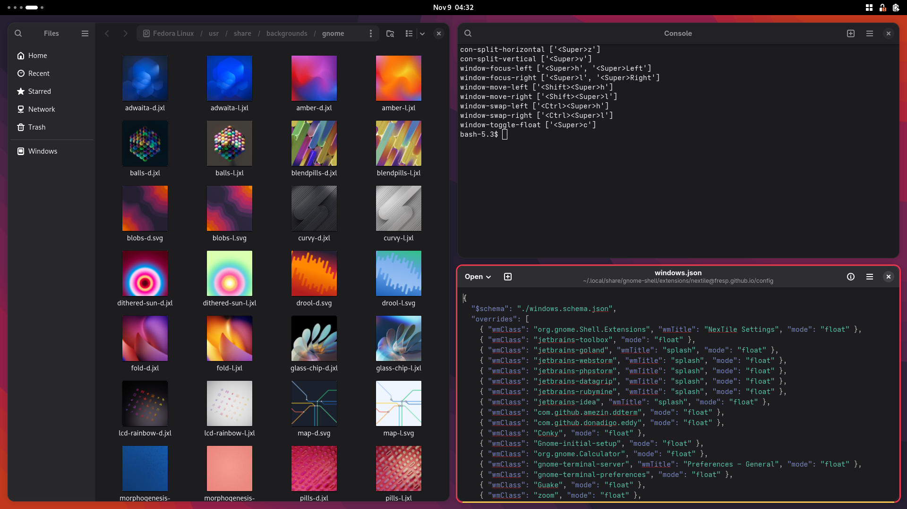
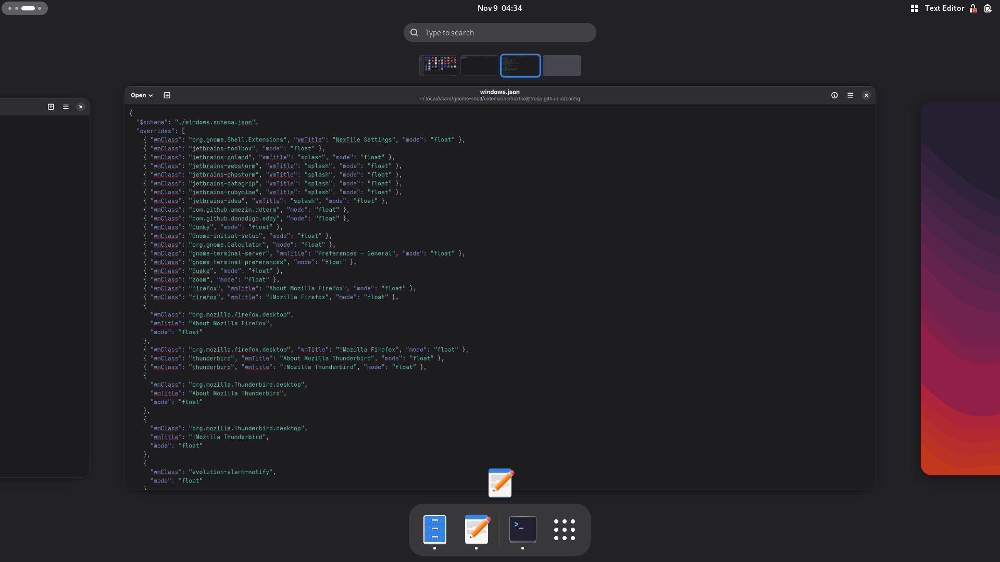

# NexTile

i3/sway-style tiling for GNOME Shell 45–51, on X11 and Wayland, with
workspace-centric window placement.

- Tree-based tiling: nested horizontal/vertical splits, stacked and tabbed
  containers, monocle. See [layouts](docs/user/layouts.md).
- Launch-to-workspace auto-tiling: each newly launched application window moves
  to a fresh workspace and is tiled there, leaving your current workspace
  untouched. See [configuration](docs/user/config.md).
- Vim-style keyboard control with an on-screen cheatsheet. See
  [keybindings](docs/user/keybindings.md).
- Drag-and-drop tiling, floating windows and per-app [window rules](docs/user/rules.md).
- Per-monitor, per-workspace trees. See [multi-monitor](docs/user/monitors.md).
- Settings and keybindings as [portable JSON](docs/user/config.md).

## Screenshots

**Tiling.** Files, Console and Text Editor share one workspace: a horizontal split,
with the right half split again vertically. The focused window has the red border.



**Launch to workspace.** Files, Console and Text Editor were each opened from the
dash and each got its own workspace, shown in the overview's workspace strip. The
top bar names the app the current workspace was launched for.



Both were captured on GNOME Shell 50 with the default NexTile palette and an
8 px gap.

## Install

Build from source (see [CONTRIBUTING.md](CONTRIBUTING.md)), then install the
zip:

```bash
gnome-extensions install --force nextile@fresp.github.io.zip
# log out and back in so GNOME Shell sees the extension, then:
gnome-extensions enable nextile@fresp.github.io
```

`enable` reports "does not exist" until the shell has rescanned, hence the log-out
in between.

### Upgrading from another tiling extension

NexTile ships under its own UUID (`nextile@fresp.github.io`) and its own
settings schema. If a different tiling extension is also enabled, both will try
to tile at once — disable or uninstall the other one first:

```bash
gnome-extensions list --enabled   # find the other extension's UUID
gnome-extensions disable <other-uuid>
```

Window-rule and portable-config files from another extension are not read by
NexTile; copy the JSON files you want to keep into
`~/.config/nextile/config/` and import them from Preferences → Backup.

## Use

Press **`Super+Shift+/`** for the cheatsheet of your current shortcuts and
**`Super+.`** for preferences. Everything else is in the [user guide](docs/README.md).

## Contributing

See [CONTRIBUTING.md](CONTRIBUTING.md).

## Credits

- [Forge](https://extensions.gnome.org/extension/4481/forge/) (jmmaranan and contributors), the
  GPL-3 tiling engine NexTile is forked from
- Michael Stapelberg and contributors for i3
- System76 and contributors for pop-shell
- ReworkCSS and contributors for css-parse/css-stringify
